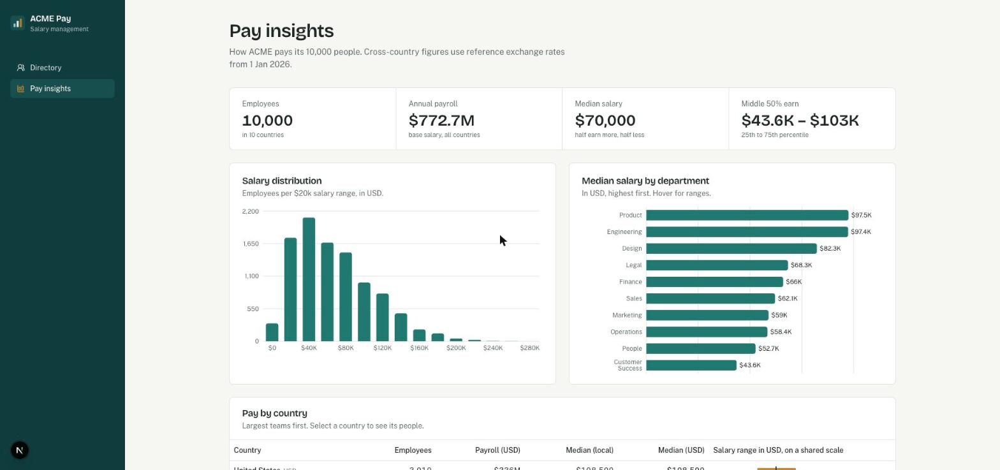
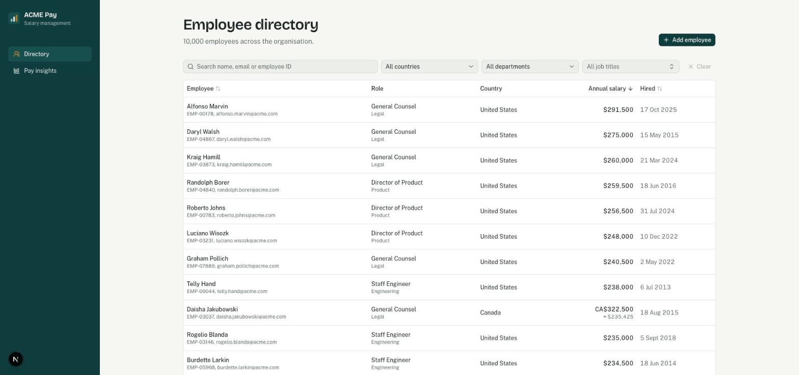
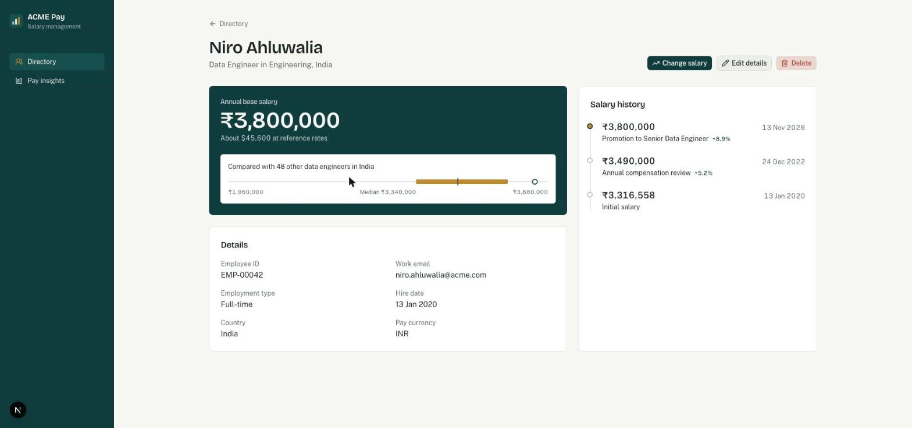

# ACME Pay: salary management

A web application for ACME's HR Manager to manage salaries for 10,000 employees across 10
countries, and to answer _"how does the organisation pay people?"_ without a spreadsheet.

- **Directory:** search, filter and sort 10k employees; add, edit and delete them.
- **Auditable pay changes:** every salary change needs a reason and lands in a history timeline.
- **Secure by default:** the HR Manager signs in before seeing anything; every API endpoint is
  protected.
- **Pay insights:** org-wide figures, distribution, pay by department, by country (local currency
  and USD) and by role, with pay bands that show where any salary sits among its peers.



| Directory                                    | Employee profile                                           |
| -------------------------------------------- | ---------------------------------------------------------- |
|  |  |

| Live app                                                                       | API                                                                                | Demo video                                                                                                  |
| ------------------------------------------------------------------------------ | ---------------------------------------------------------------------------------- | ----------------------------------------------------------------------------------------------------------- |
| [salary-management-woad.vercel.app](https://salary-management-woad.vercel.app) | [API health check](https://salary-management-api-production.up.railway.app/health) | [Watch on Google Drive](https://drive.google.com/file/d/1KiVCHn7lltlW2NnMOU8DcJp6U1h7tYQe/view?usp=sharing) |

The live app requires sign-in; credentials are shared with reviewers separately.

## Documentation

| Document                                         | What it covers                                        |
| ------------------------------------------------ | ----------------------------------------------------- |
| [Requirements](docs/01-requirements.md)          | Goal, scope, what is deliberately left out and why    |
| [Architecture](docs/02-architecture.md)          | System, layering, data model, API, frontend structure |
| [Decisions and trade-offs](docs/03-decisions.md) | Each significant choice, its cost and when to revisit |
| [Performance](docs/04-performance.md)            | Measurements, what keeps it fast, known limits        |
| [AI workflow](docs/05-ai-workflow.md)            | How AI tools were used and how output was verified    |

## Tech stack

| Layer   | Choice                                                                                          |
| ------- | ----------------------------------------------------------------------------------------------- |
| API     | Node 22, TypeScript, Fastify 5, Drizzle ORM, SQLite (better-sqlite3), zod                       |
| Web     | Next.js 16, React 19, shadcn/ui (Radix), Tailwind v4, TanStack Query, react-hook-form, Recharts |
| Testing | Vitest, Testing Library, Fastify `inject` against in-memory SQLite                              |
| Tooling | pnpm workspaces, ESLint, Prettier, GitHub Actions                                               |

## Getting started

Requirements: Node 22+ and pnpm 10+ (`corepack enable`).

```bash
pnpm install

# API: http://localhost:4000
cp apps/api/.env.example apps/api/.env
pnpm db:seed                       # 10,000 deterministic employees (~0.4s)
pnpm --filter @salary/api dev

# Web: http://localhost:3000 (in a second terminal)
cp apps/web/.env.example apps/web/.env.local
pnpm --filter @salary/web dev
```

Sign in locally with `hr.manager` / `local-dev-password`. These credentials are defined in
`apps/api/.env.example` and are for local development only.

If ports 3000/4000 are taken, set `PORT` in `apps/api/.env`, `API_URL` in
`apps/web/.env.local`, and run the web app with `-- --port <n>`.

Seed options: `pnpm db:seed --count=500`, `--seed=7` (different but reproducible data), and
`--if-empty` (only seed a fresh database; used on deploy).

## Quality checks

```bash
pnpm test        # 94 API + 37 web tests
pnpm typecheck
pnpm lint
pnpm build
```

The same checks run in CI on every push.

**What the tests cover:**

- **API:** statistics maths (matching spreadsheet PERCENTILE.INC), currency conversion, seed
  determinism and realism, employee business rules (salary history, relocation across
  currencies, duplicate emails, search escaping, USD-normalised sorting), insights
  aggregation, every HTTP route including error contracts, and authentication (password hashing,
  session expiry and tampering, rate limiting, and a 401 check for every protected endpoint).
- **Web:** formatting, API error mapping, URL state parsing, form validation and form-to-API
  diffing, safe post-login redirects, and pay band accessibility and geometry.

## Deployment

**API on Railway:** [`railway.json`](railway.json) builds the API from its multi-stage
[`Dockerfile`](apps/api/Dockerfile). On start, the container runs migrations, seeds 10k
employees only if the database is empty, then serves.

- Attach a volume mounted at `/data` so the SQLite database and edits persist across deploys.
- Set the sign-in variables:

  | Variable             | Value                                                    |
  | -------------------- | -------------------------------------------------------- |
  | `AUTH_USERNAME`      | the HR Manager's username, e.g. `hr.manager`             |
  | `AUTH_PASSWORD_HASH` | output of `pnpm --filter @salary/api auth:hash-password` |
  | `SESSION_SECRET`     | 32+ random characters, e.g. `openssl rand -base64 48`    |

  The API refuses to start if any of these are missing or malformed.

A [`render.yaml`](render.yaml) blueprint is also included for deploying the same image on Render.

**Web on Vercel:** import the repository, set **Root Directory** to `apps/web`, and set
`API_URL` to the API origin. The web app proxies `/api/*` there, so the API needs no CORS
settings, and the build fails fast if `API_URL` is missing.

## Repository layout

```
apps/
  api/        REST API, database schema and migrations, seed script
  web/        Next.js frontend
docs/         requirements, architecture, decisions, performance, AI workflow
```
