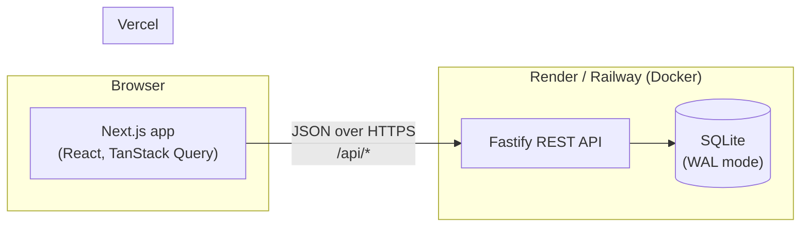
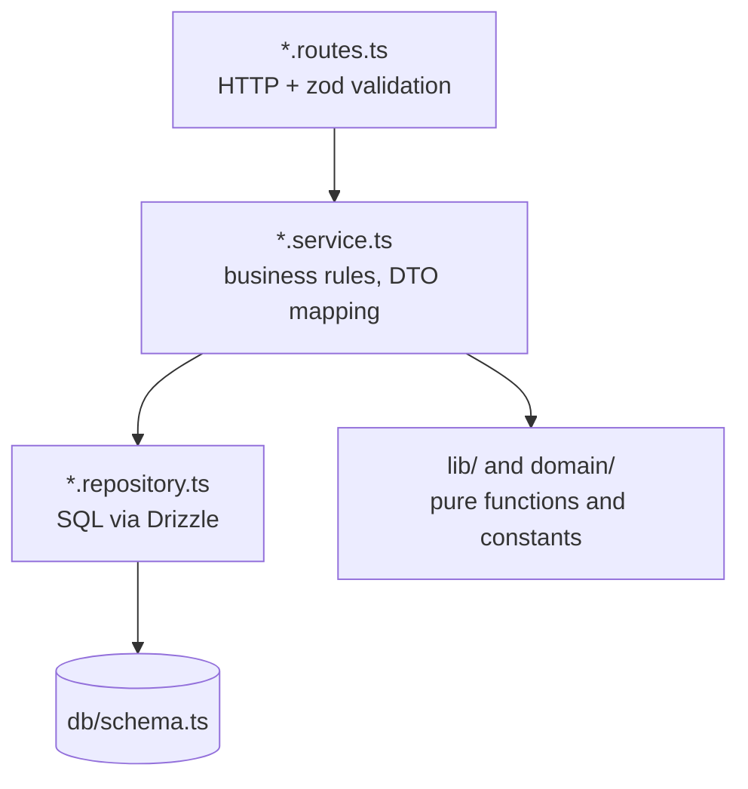
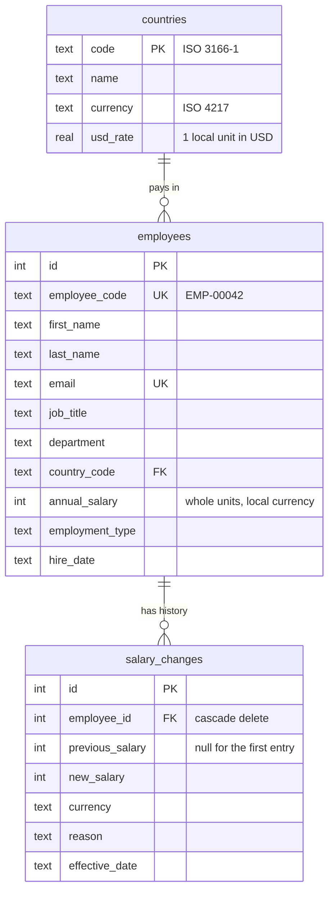

# Architecture

## System overview



Two deployable units in one pnpm workspace:

| Unit | Path       | Stack                                                       | Hosting                  |
| ---- | ---------- | ----------------------------------------------------------- | ------------------------ |
| API  | `apps/api` | Node 22, TypeScript, Fastify 5, Drizzle ORM, better-sqlite3 | Docker on Render/Railway |
| Web  | `apps/web` | Next.js 16 (App Router), React 19, shadcn/ui, Recharts      | Vercel                   |

## Backend layering

Each feature is a module with the same three layers. Dependencies point one way: inwards.



```
apps/api/src
├── app.ts                  buildApp(): wires modules, CORS, error envelope
├── server.ts               process entry: config → migrate → listen
├── config.ts               env vars validated with zod
├── db/                     schema, connection, migrations runner
├── domain/                 departments, employment types, countries + FX rates
├── lib/                    statistics (median/percentiles/histogram), currency, errors
├── modules/
│   ├── employees/          CRUD, search/filter/sort/paginate, salary changes
│   ├── insights/           pay summary and role benchmarks (pure calculations)
│   └── reference/          lookup data for UI filters and forms
└── seed/                   deterministic generator for 10,000 employees
```

- **Routes** parse input with zod schemas and nothing else. A `ZodError` becomes a 400 in one
  central error handler.
- **Services** hold the rules. Examples: a salary change needs a reason and must actually change
  the amount, and relocating to a country with another currency requires a new salary.
- **Repositories** own all SQL. Multi-step writes (create employee + first history row; update
  - salary history row) run in one transaction.
- **`buildApp({ db })`** takes its dependencies as arguments, so HTTP tests run the real stack
  against an in-memory database in milliseconds.

### Error contract

Every non-2xx response has the same shape, so the UI handles errors in one place:

```json
{
  "error": {
    "code": "VALIDATION_ERROR",
    "message": "…",
    "details": [{ "path": "email", "message": "…" }]
  }
}
```

| Status | Code                      | When                                                                |
| ------ | ------------------------- | ------------------------------------------------------------------- |
| 400    | `VALIDATION_ERROR`        | Request fails schema validation                                     |
| 404    | `NOT_FOUND`               | Unknown employee or route                                           |
| 409    | `CONFLICT`                | Duplicate email                                                     |
| 422    | `BUSINESS_RULE_VIOLATION` | Valid shape, but breaks a rule (e.g. relocation without new salary) |
| 500    | `INTERNAL_ERROR`          | Anything unexpected (logged, never leaked)                          |

## Data model



Indexes cover every filter and sort the directory offers (country, department, job title, name,
hire date) plus `(employee_id, effective_date)` for history lookups.

## API surface

| Method | Path                    | Purpose                                                                                  |
| ------ | ----------------------- | ---------------------------------------------------------------------------------------- |
| GET    | `/health`               | Liveness probe                                                                           |
| GET    | `/api/reference`        | Countries, departments, job titles, FX "as of" date                                      |
| GET    | `/api/employees`        | `search`, `country`, `department`, `jobTitle`, `sortBy`, `sortOrder`, `page`, `pageSize` |
| GET    | `/api/employees/:id`    | Employee with salary history                                                             |
| POST   | `/api/employees`        | Create (writes the first salary history entry)                                           |
| PATCH  | `/api/employees/:id`    | Partial update; `salaryChange: { annualSalary, reason, effectiveDate? }`                 |
| DELETE | `/api/employees/:id`    | Delete (cascades history)                                                                |
| GET    | `/api/insights/summary` | Org overview, by country, by department, distribution                                    |
| GET    | `/api/insights/roles`   | Pay per job title; `country` (local currency) and `department`                           |

## Frontend structure

```
apps/web/src
├── app/                    routes only: /employees, /employees/[id], /insights
├── features/
│   ├── employees/          directory, filters, table, form sheet, profile, dialogs
│   └── insights/           overview, charts, country table, role explorer
├── components/             app shell, PayBand, form field, states, shadcn/ui
├── lib/                    api-client, query hooks + keys, formatters, API types
└── hooks/
```

- **Server state lives in TanStack Query**, never copied into component state. All query keys
  are in `lib/queries.ts`, and every mutation invalidates the employees, insights and reference
  caches it can affect.
- **Directory state lives in the URL** (`?country=DE&sortBy=salary&page=3`), so views are
  shareable and survive reloads. Parsing is a pure, tested function that ignores tampered values.
- **Forms** use react-hook-form + zod schemas that mirror the API rules. API field errors are
  mapped back onto the matching inputs.
- **PayBand** is the one custom visual: min/P25/median/P75/max as a strip, used for countries,
  roles and to place an individual among their peers.
